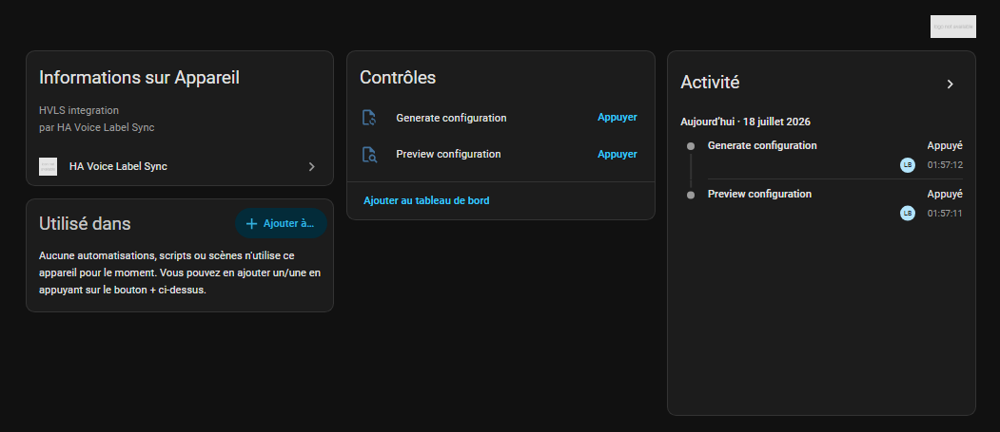

# HA Voice Label Sync

[](https://github.com/flimo44/ha-voice-label-sync/actions/workflows/python-check.yml)
[](https://github.com/flimo44/ha-voice-label-sync/releases)
[](https://pepy.tech/projects/ha-voice-label-sync)
[](https://pepy.tech/projects/ha-voice-label-sync)
[](https://buymeacoffee.com/plebonhommx)

> **Already using Google Assistant with Home Assistant without Home Assistant Cloud? Easily manage exposed entities using labels.**

For the **manual Home Assistant Google Assistant integration** (without Home Assistant Cloud), use native Home Assistant labels to choose exposed entities. **Select → Review → Apply:** HVLS prepares a Preview automatically after label changes, shows entity-level differences, and only updates production after your explicit review and confirmation.

> [!IMPORTANT]
> **HA Voice Label Sync (HVLS) is not a voice assistant integration.**
>
> HVLS complements the official Home Assistant [Google Assistant integration](https://www.home-assistant.io/integrations/google_assistant/#manual-setup). It does **not** create your Google Cloud project, service account, or Google Home connection. You can select entities, inspect a Preview and manage the YAML **without Google Assistant being connected**; configure Google Assistant separately only when you want to expose the selected entities to Google Home.

**Latest published stable:** [`v1.1.2`](https://github.com/flimo44/ha-voice-label-sync/releases/tag/v1.1.2) (published on 2026-11-17). Download the release ZIP from [GitHub Releases](https://github.com/flimo44/ha-voice-label-sync/releases).  
**Python core dependency:** `ha-voice-label-sync==0.3.7` (published on PyPI and required by the Home Assistant integration's `manifest.json`).

## 🔐 v1.1.2 — Security and reliability

- **Safer Google Assistant YAML:** names and rooms are consistently quoted as strings; Unicode whitespace in room comments cannot inject additional YAML entities.
- **Removal safeguards:** deleting at least 3 entities and at least half of the production selection requires an explicit confirmation before Apply.
- **Localized feedback:** the unsafe output-path error is translated in the options flow.
- As always, review the Preview before Apply; the Python core package version is independent of the Home Assistant integration version.

Historical beta milestones and migration notes are documented in [CHANGELOG.md](CHANGELOG.md).

## ✨ V1 stable highlights

- **At-a-glance production status:** green ✓ for entities already present unchanged in production YAML, amber dot for pending additions or modifications and neutral ? when the comparison cannot be trusted. These indicators do **not** confirm Google Home synchronization.
- **Guided Preview / Production workflow:** visible pending-changes warning and explicit, checksum-protected Apply.
- **Safe recovery:** browse historical backups, review a clear restore plan (what is restored, what changed in Home Assistant since the backup and what Google will finally receive), and restore after creating a mandatory safety copy.
- **Live entity selection:** manage the HVLS label, inspect eligibility and open HA entity details without leaving the integration.

## 🧪 V1 beta release history

### v1.0.0-beta.5 — Guided workflow and quick removal

- **Pending changes alert:** when a valid, actionable Preview differs from production, Statistics displays a prominent warning with the number of entity changes awaiting review and a direct **Open Preview** action.
- **Quick HVLS removal:** in Statistics, expand a domain or area and uncheck **HVLS** beside a selected entity. The same confirmation and concurrency-safe registry update used by Entity Management applies. Both views refresh after successful removal.
- **Automatic Preview refresh:** after a label change, HVLS reloads the current Home Assistant registry, regenerates the Preview and updates statistics. **It never automatically applies production changes.**
- The visual warning respects reduced-motion accessibility preferences.

### v1.0.0-beta.4 — Backup browsing and protected restoration

- **Backups** tab with timestamps, file sizes and entity counts.
- Select a backup to review directional differences with production, including added, removed, modified and unchanged entities, with field-level detail.
- Explicit administrator-only restore, SHA-256 validation of backup and production, **mandatory pre-restore safety backup**, YAML validation and atomic replacement.
- Restoring changes **only** the generated Google Assistant YAML, never Home Assistant entity labels or registries.
- Expand Statistics by domain **and** by area; the **Without area** bucket is last.
- Open native Home Assistant entity details from Statistics, Entity Management or Preview change lists.

### V1 panel at a glance

Four main tabs: **Statistics**, **HVLS Entity Management**, **Preview**, **Backups**. **Excluded entities** appears as an additional tab only when needed.

**Select → Review → Apply → Restore if needed.** You can select or deselect entities using the native HA label, inspect differences and explicitly apply the reviewed Preview. Applying changes to production remains separate from editing labels. The backup history provides a recovery path if necessary.

The guided Google Assistant cloud project, DNS/HTTPS and Google Home setup wizard remains **planned for V2**; it is not implemented in these beta releases.

## ✨ Why HVLS?

Maintaining large Google Assistant `entity_config` sections by hand is tedious and error-prone. HVLS lets you select entities using a Home Assistant label and review proposed changes before writing them.

- 🏷️ Select entities through Home Assistant labels
- 🏠 Resolve names, areas and devices from **live Home Assistant registries** in the native integration
- 🏷️ Avoid duplicate Google names: an entity that only has a generic name (such as *Temperature* or *Humidity*) is prefixed with its device name; names you set yourself are kept as typed
- 👀 Generate a dedicated Preview and inspect statistics by domain and room, including labeled entities in non-enabled domains
- 🔍 See excluded entities and the reasons they were filtered out
- ⚙️ Open the integration configuration from the Preview panel
- 🎨 Identify Preview generation and production application with distinct blue and green actions
- 📊 Compare the Preview with the current production YAML (added, removed, modified, unchanged)
- 🚨 Highlight pending changes with a shortcut to the Preview tab
- ☑️ Remove labeled entities directly from Statistics (by domain or area), with confirmation
- 🗃️ Browse, compare and safely restore previous production YAML backups
- ✅ Apply a reviewed Preview with SHA-256 change detection
- 💾 Preserve the previous configuration with optional automatic backups and retention
- 🔒 Apply production changes only after explicit review in HVLS Preview; legacy direct generation is disabled
- 🔌 Keep the architecture open for future voice assistant backends
- 📦 Install from the HACS/Marketplace catalog using the release ZIP asset
- 🧹 Use a content-based SHA-256 fingerprint in the panel JavaScript URL to reduce stale browser caching (available since v0.3.10)

## 📸 Screenshots

The screenshots illustrate the **V1 interface** developed and tested through beta.5, including Statistics, Entity Management, Preview and Backups. Some screenshots predate the final production-status indicators.

### Home Assistant configuration


### HVLS panel — V1


### Generated YAML




## 🚀 Installation

### Install with the Home Assistant Marketplace / HACS (recommended)

**HA Voice Label Sync is listed in the HACS catalog and can be discovered through the Home Assistant Marketplace where available.** A custom repository is not required for a standard installation.

1. Open **Marketplace / HACS** in Home Assistant and search for **HA Voice Label Sync**.
2. Select the latest **published stable** release (see [GitHub Releases](https://github.com/flimo44/ha-voice-label-sync/releases)); HACS pre-release selection is only needed if you intentionally want a beta.
3. Restart Home Assistant.
4. Go to **Settings → Devices & services → Add integration**.
5. Search for **HA Voice Label Sync**, add it and configure its options.
6. Open **HA Voice Label Sync** in the sidebar. If the panel still shows an older interface after a manual update, confirm Home Assistant was restarted: its JavaScript asset fingerprint is computed when the integration initializes.

**Requirements**

- Home Assistant **2025.7.0 or later** (as declared in `hacs.json`; compatibility with every release has not been individually verified)
- An existing and working [Google Assistant integration](https://www.home-assistant.io/integrations/google_assistant/#manual-setup) for actual Google Home exposure

### Manual installation

Download the desired [GitHub release](https://github.com/flimo44/ha-voice-label-sync/releases). For ZIP-based releases, extract `ha_voice_label_sync.zip` and ensure the integration files end up in `/config/custom_components/ha_voice_label_sync/`. Restart Home Assistant, then add the integration under **Devices & services**. Its Python core dependency is specified in `manifest.json`.

## ⚙️ Google Assistant configuration

HVLS generates a separate entity configuration YAML file. The default production output is:

```text
/config/google_assistant_entities.yaml
```

Include it in your **existing** `configuration.yaml` Google Assistant setup:

```yaml
google_assistant:
  project_id: YOUR_PROJECT_ID
  service_account: !include google_key.json
  report_state: true
  expose_by_default: false
  entity_config: !include google_assistant_entities.yaml
```

This is an example: retain your actual project settings, credentials and other Google Assistant options. HVLS does not create `google_key.json` or configure Google Cloud.

> [!IMPORTANT]
> Applying a generated `entity_config` file does **not**, by itself, guarantee that Google Home has received the new device list. Reload the Google Assistant integration if available in your installation (or restart Home Assistant), then request a Google device sync if necessary. HVLS does not yet automate this end-to-end.

## 🧭 Recommended workflow: Select → Review → Apply

```text
🏷️ Select eligible entities with the HVLS label in HA or Entity Management
                   ↓
🔄 Refresh or generate the Preview from live HA registries
                   ↓
🚨 Statistics highlights pending differences, if any
                   ↓
🔍 Open Preview and review additions, removals and changes
                   ↓
✅ Explicitly confirm Apply Preview
                   ↓
💾 Back up production (when enabled) and write atomically
                   ↓
🔄 Reload Google Assistant or restart HA, then sync Google Home if needed
```

### Backup history and safe restore

The **Backups** tab lists snapshots stored in a `.hvls_backups` directory beside the configured production YAML. Selecting a backup and choosing to restore it opens a **restore plan** in the Preview tab. Nothing is written until you apply it: neither the YAML nor Home Assistant labels change while you review.

The plan opens on the **recommended restoration**, computed by HVLS:

- the result follows the backup;
- entities that can no longer be regenerated are left out;
- entities renamed or moved in Home Assistant since the backup are restored with their current name and room.

A summary shows how many backup entities are restored (for example **25 / 40**), how many entities will be exposed after restoration, how many are added, already exposed, or will no longer be exposed. Each entity then appears in exactly one of three columns; the ⓘ button beside each title explains it:

| Column | Content | Possible actions |
| --- | --- | --- |
| **Not restored** | Backup entities that will not be brought back. Entities marked **impossible** no longer exist, are no longer eligible, are not exposed in the backup or have options HVLS does not generate (such as aliases). Others were left out by you. | **Restore →** when the entity can be restored |
| **Name or room changed** | Entities renamed or moved in Home Assistant since the backup, shown as *backup value → current value*. They are restored with today's name and room. | **← Withdraw** |
| **Result for Google** | Exactly what will be written: **added**, **already exposed**, **current name/room**, and in red the entities **exposed today but absent from the backup**, which will be removed. | **Don't restore**, **Keep** / **Withdraw**, and **Keep all** / **Remove all** for entities absent from the backup |

By default the result is the backup's result. If the backup is incomplete, keep the entities exposed today that it does not contain, one by one or with **Keep all**. **↺ Back to the recommendation** resets your choices. The underlying HA label operations remain available under **Technical details**, and the YAML diff stays below the plan.

Restore is administrator-only. Every choice is recalculated by Home Assistant; the browser only proposes it. At **Apply**, HVLS re-checks the backup and production SHA-256 fingerprints, current ownership and your exact choices. The final confirmation summarises the result and lists the entities removed, restored with current values and not restored. A current production file is always backed up before replacement; if the file is missing, there is no current file to back up, and existing backups are preserved. HVLS then updates the HVLS labels, verifies that they reproduce the restored YAML and protects incomplete restore operations. After restoration, reload Google Assistant or restart Home Assistant and sync devices if necessary.

The panel offers the following actions plus a **Settings** shortcut:

| Action | What it does |
| --- | --- |
| **Generate Preview** | Regenerates `/config/.hvls/preview.yaml` using the current HA registries, then refreshes the panel. Does not write the production file. |
| **Refresh** | Reloads the live HA entity catalog, regenerates Preview YAML and refreshes statistics and differences. Does **not** apply to production. |
| **Copy YAML** | Copies the generated Preview content. |
| **Apply Preview** | Requests confirmation, checks the reviewed Preview and production SHA-256 fingerprints, then writes to the configured production path, with a backup when enabled. |
| **Backups** | Lists backups and opens a reviewed restore plan (recommended by default, adjustable entity by entity), then safely restores with explicit confirmation. |
| **Settings** | Opens the Home Assistant integration details/configuration page. |

The panel displays entity counts, expandable breakdowns by domain and area, excluded-domain diagnostics and a Preview/Production comparison. Entity names open HA's native More Info dialog; in Statistics, the **HVLS** checkbox allows quick removal with confirmation. A warning highlights unapplied changes and links to Preview. **Apply Preview** remains an explicit, separate production action.

> [!WARNING]
> **Apply Preview and Restore can change the configured production YAML; reviewed restoration can also update HVLS entity labels.** Review the Preview or restore plan before confirming. HACS rollback restores integration code, **not** generated YAML or HA labels. Ordinary automatic backups are optional; a restore of an existing production file creates a safety backup. When the file is missing, existing backups are preserved and a new safety copy cannot be made. With the default output directory, backups are under `/config/.hvls_backups/`.

### Native Home Assistant actions

The legacy **Generate configuration** and **Preview configuration** Home Assistant button entities are retired. The legacy `ha_voice_label_sync.generate` service remains registered only to return an explicit error: direct generation is disabled. Use the HVLS panel's **Preview → Apply** workflow for all production changes. Existing automations using the legacy service must be updated.

## 🔍 Check Google Assistant

Open **Settings → Devices & services → HA Voice Label Sync → Configure → Check Google Assistant** for a read-only inspection of the Google Assistant settings detected by HVLS.

The checker reports the presence of `google_assistant:`, `project_id`, `report_state`, `expose_by_default`, the service-account reference, the `entity_config` reference, the referenced file's existence, and potential path mismatches or configuration warnings.

It does **not** read your service-account JSON contents, modify `configuration.yaml`, regenerate entity files, or verify connectivity to Google Cloud.

The integration also provides a separate **HVLS settings** options flow.

## 🧩 Entity eligibility and exclusions

Adding the HVLS label makes an entity a **candidate**, not a guarantee that it will appear in the generated Google Assistant YAML. HVLS applies the selection rules below. These lists describe **HVLS eligibility**, not every entity type that Google Assistant might support independently.

### Domains enabled by the Home Assistant integration

The native integration enables these **14 domains** by default:

| | | |
| --- | --- | --- |
| `binary_sensor` | `climate` | `cover` |
| `fan` | `input_boolean` | `input_select` |
| `light` | `lock` | `scene` |
| `script` | `select` | `sensor` |
| `switch` | `vacuum` | |

> **CLI difference:** The standalone CLI defaults to the same list **except** `sensor` and `binary_sensor` (12 domains). This section otherwise describes the native Home Assistant integration.

### Supported `sensor` device classes

Only `sensor` entities with one of these `device_class` values are selected:

| Device class | Description |
| --- | --- |
| `temperature` | Temperature |
| `humidity` | Humidity |
| `aqi` | Air quality index |
| `carbon_dioxide` | CO₂ |
| `carbon_monoxide` | Carbon monoxide |
| `pm10` | PM10 |
| `pm25` | PM2.5 |
| `volatile_organic_compounds` | Volatile organic compounds |

A sensor with a missing or different device class (for example `power`, `energy`, or a pH measurement without a supported class) is **not selected**, even if it has the HVLS label.

### Supported `binary_sensor` device classes

Only these `binary_sensor` device classes are selected:

| Device class | Description |
| --- | --- |
| `carbon_monoxide` | Carbon monoxide detection |
| `door` | Door |
| `garage_door` | Garage door |
| `lock` | Lock |
| `moisture` | Moisture / water detection |
| `opening` | Opening |
| `smoke` | Smoke detection |
| `window` | Window |

**Example:** A Zigbee2MQTT rain `binary_sensor` configured in Home Assistant as **Show as → Moisture** may become eligible if its effective `device_class` is `moisture`. This does not change the Zigbee device itself.

### Other reasons an entity may be excluded

An entity is also skipped when it:

- belongs to a domain not enabled in HVLS (`domain_not_enabled`);
- has an unsupported `sensor` or `binary_sensor` device class (`unsupported_device_class`);
- is disabled (`disabled`) or hidden (`hidden`);
- belongs to the `diagnostic` or `config` entity category (`entity_category`);
- does not carry the selected HVLS label.

The Preview panel shows included-entity counts **by domain and room**. Under **Non-enabled domains**, it groups *labeled* entities excluded because their domain is not enabled; the **Excluded entities** diagnostic lists labeled exclusions and their reasons. Entities without the selected label are not included in these exclusion statistics.

> **Note:** The current Home Assistant integration v1.1.2 requires the separately versioned Python core `ha-voice-label-sync==0.3.7`. Check `manifest.json` and `pyproject.toml` when changing core behavior or eligibility.

## 🏠 Home Assistant integration features

- Native configuration and options flows
- Separate **HVLS settings** and **Check Google Assistant** options
- Live entity, device, area and label registries
- Preview generation and explicit, reviewed Preview → Apply actions (legacy direct generation is disabled)
- WebSocket Preview, diagnostics, reviewed Apply, backup browsing and safe Restore operations
- SHA-256 guards, serialized HVLS workflows, atomic writes, optional ordinary backups and mandatory pre-restore safety copies
- English and French translations
- Python/JavaScript regression tests and GitHub Actions validation

## 🐍 Python engine and CLI

The project also provides a standalone Python package and CLI for advanced usage. The Python core version and the Home Assistant integration version are **separate**.

```bash
pip install ha-voice-label-sync
hvls --help

hvls \
  --storage /config/.storage \
  --output /config/google_assistant_entities.yaml \
  --label google_assistant
```

The standalone CLI reads registry files in Home Assistant `.storage`. **The native Home Assistant integration uses live/in-memory Home Assistant registries** instead; this migration is already implemented.

## 🎤 Supported voice assistants

| Backend | Status |
| --- | --- |
| Google Assistant | ✅ Supported for configuration generation |
| Amazon Alexa | 🚧 Planned |
| Apple HomeKit | 📋 Planned |

## 🏗️ Architecture

```text
Home Assistant labels / live registries
                 │
                 ▼
      HA Voice Label Sync
                 │
        Preview / diagnostics
                 │
        Review and Apply
                 │
                 ▼
    Generated entity_config YAML
                 │
                 ▼
Official Google Assistant integration
                 │
                 ▼
              Google Home
```

Future backends may share the label-driven workflow. Only Google Assistant YAML generation is currently implemented.

## 🧪 Tests and releases

For v1.1.2, the release-candidate checks passed Python, JavaScript, HACS validation, Hassfest, package checks and the Home Assistant sandbox. The bulk-removal confirmation and YAML string-quoting changes were also exercised on an isolated Synology Home Assistant VM before the stable release.

See [GitHub Releases](https://github.com/flimo44/ha-voice-label-sync/releases) for the latest tagged and published version and [CHANGELOG.md](CHANGELOG.md) for details. The v1.0.0 stable release is distinct from the earlier beta.5 pre-release.

## 🧩 Recent interface changes

### v0.3.9 — Panel usability

- Sidebar and page title: **HA Voice Label Sync** (without “Preview”).
- Direct **Settings** button to reach the integration configuration.
- Distinct blue **Generate Preview** and green **Apply Preview** buttons.
- **Non-enabled domains** section below the domain breakdown, counting only labeled candidates omitted because their domains are not enabled.

### v0.3.10 — Frontend cache-busting change

The frontend panel now computes a shortened SHA-256 hash of `hvls-preview-panel.js` at Home Assistant setup time and appends it to the script URL (for example `?v=<hash>`). Changing the JS changes the URL on the next integration setup, reducing the chance of stale browser assets. This behavior is available since the published v0.3.10 release.

> This reduces HTTP caching problems but does not force an already open browser tab to hot-reload its JavaScript. After upgrades, a Home Assistant restart and page reload may still be needed.

### v1.0.0-beta.4 and beta.5 — Recovery and guided workflows

Beta.4 added backup browsing and protected restore, more detailed Preview views and expandable statistics by area. Beta.5 added the pending-Preview alert and quick HVLS checkbox removal from Statistics.

## 🛣️ Roadmap after V1

- **V1 maintenance:** monitor early feedback, installation compatibility and regression reports after the stable release.
- **V2:** guided Google Assistant setup with a step-by-step checklist and verified prerequisites (external DNS/HTTPS, Google Cloud project, service account, Home Assistant and Google Home connection).
- **Under investigation:** safer automation of Google Assistant reload and Google Home device synchronization after Apply; not implemented in V1.

## 📚 Documentation and roadmap

See [ROADMAP.md](ROADMAP.md) for future milestones and the [`docs/`](docs/) directory for additional documentation.

## ☕ Support the project

HVLS is free and open source. If you find it useful and would like to support its continued development and maintenance, you can [buy me a coffee](https://buymeacoffee.com/plebonhommx). Contributions are entirely optional and are always appreciated!

## 🤝 Contributing

Bug reports, feature requests and pull requests are welcome. Please use [GitHub Issues](https://github.com/flimo44/ha-voice-label-sync/issues).

## 📄 License

See the repository's license file for the applicable terms.

MIT


### Beta.5 changes and migration note

The two legacy HA integration buttons are intentionally removed. The old `ha_voice_label_sync.generate` service now raises an explicit error, so automations referencing it must be reviewed; it no longer writes production YAML without approval. Open the HVLS panel from Home Assistant's sidebar or the **Visit** link in the integration's service-device details. Use **Select → Preview → Apply** for all output changes. The native Preview/Apply flow and safeguards are unchanged. Unapplied UI drafts should be applied or canceled before upgrades, browser reloads or migration; see [issue #170](https://github.com/flimo44/ha-voice-label-sync/issues/170).
