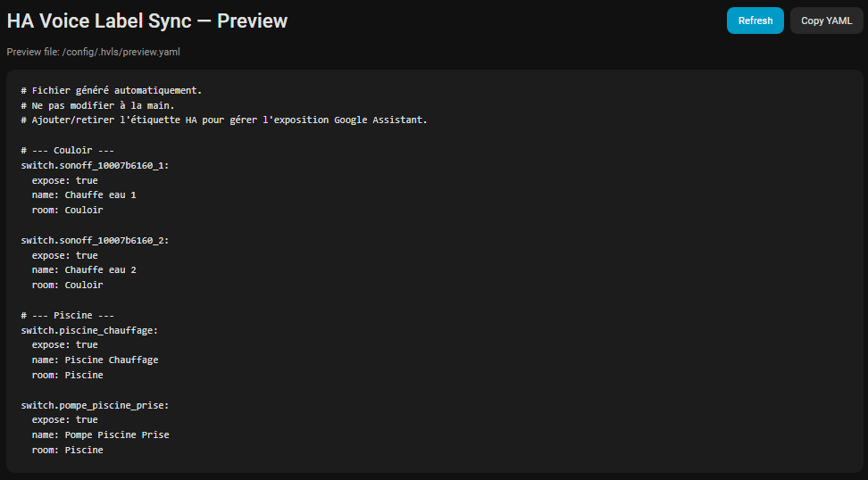
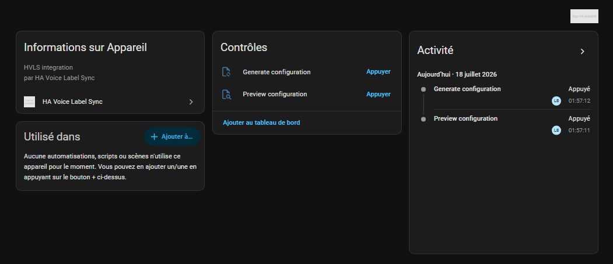

# HA Voice Label Sync

[](https://github.com/flimo44/ha-voice-label-sync/actions/workflows/python-check.yml)
[](https://github.com/flimo44/ha-voice-label-sync/releases)
[](https://pepy.tech/projects/ha-voice-label-sync)
[](https://pepy.tech/projects/ha-voice-label-sync)

> **Manage once in Home Assistant. Sync everywhere.**

Generate Google Assistant entity exposure configuration from **Home Assistant labels**. Select eligible entities, generate and review a YAML Preview, compare it with production, and apply reviewed changes with safeguards and backups.

> [!IMPORTANT]
> **HA Voice Label Sync (HVLS) is not a voice assistant integration.**
>
> HVLS complements the official Home Assistant [Google Assistant integration](https://www.home-assistant.io/integrations/google_assistant/#manual-setup). It does **not** create your Google Cloud project, service account, or Google Home connection. Set up and verify Google Assistant before using HVLS.

**Latest release:** `v0.3.10` (stable). Check [GitHub Releases](https://github.com/flimo44/ha-voice-label-sync/releases) for the latest published version.  
**Python core dependency:** `ha-voice-label-sync==0.3.5` (separate from the Home Assistant integration version).

> [!NOTE]
> HVLS remains under active development and has not yet reached v1.0. Its Home Assistant integration and standalone PyPI core have independent version numbers. Feedback and issue reports are welcome.

## ✨ Why HVLS?

Maintaining large Google Assistant `entity_config` sections by hand is tedious and error-prone. HVLS lets you select entities using a Home Assistant label and review proposed changes before writing them.

- 🏷️ Select entities through Home Assistant labels
- 🏠 Resolve names, areas and devices from **live Home Assistant registries** in the native integration
- 👀 Generate a dedicated Preview and inspect statistics by domain and room, including labeled entities in non-enabled domains
- 🔍 See excluded entities and the reasons they were filtered out
- ⚙️ Open the integration configuration from the Preview panel
- 🎨 Identify Preview generation and production application with distinct blue and green actions
- 📊 Compare the Preview with the current production YAML (added, removed, modified, unchanged)
- ✅ Apply a reviewed Preview with SHA-256 change detection
- 💾 Preserve the previous configuration with optional automatic backups and retention
- ⚡ Trigger Preview or direct generation through native Home Assistant actions
- 🔌 Keep the architecture open for future voice assistant backends
- 📦 Install from the HACS/Marketplace catalog using the release ZIP asset
- 🧹 Use a content-based SHA-256 fingerprint in the panel JavaScript URL to reduce stale browser caching (available since v0.3.10)

## 📸 Screenshots

> Some screenshots below show earlier versions. The current panel uses the **HA Voice Label Sync** title, a Settings button, blue Generate Preview and green Apply Preview buttons, and a non-enabled domains section.

### Home Assistant configuration


### Preview panel





### Generated YAML



## 🚀 Installation

### Install with the Home Assistant Marketplace / HACS (recommended)

**HA Voice Label Sync is listed in the HACS catalog and can be discovered through the Home Assistant Marketplace where available.** A custom repository is not required for a standard installation.

1. Open **Marketplace / HACS** in Home Assistant and search for **HA Voice Label Sync**.
2. Download the latest **published** release (check [GitHub Releases](https://github.com/flimo44/ha-voice-label-sync/releases)).
3. Restart Home Assistant.
4. Go to **Settings → Devices & services → Add integration**.
5. Search for **HA Voice Label Sync**, add it and configure its options.
6. Open **HA Voice Label Sync** in the sidebar. If an older UI persists on versions before the cache fix, use a browser hard reload or clear the site cache.

**Requirements**

- Home Assistant **2025.7.0 or later** (as declared in `hacs.json`; compatibility with every release has not been individually verified)
- An existing and working [Google Assistant integration](https://www.home-assistant.io/integrations/google_assistant/#manual-setup) for actual Google Home exposure

### Manual installation

Download the desired [GitHub release](https://github.com/flimo44/ha-voice-label-sync/releases). For ZIP-based releases, extract `ha_voice_label_sync.zip` and ensure the integration files end up in `/config/custom_components/ha_voice_label_sync/`. Restart Home Assistant, then add the integration under **Devices & services**. Its Python core dependency is specified in `manifest.json`.

## ⚙️ Google Assistant configuration

HVLS generates a separate entity configuration YAML file. The default production output is:

```text
/config/google_assistant_entities.yaml
```

Include it in your **existing** `configuration.yaml` Google Assistant setup:

```yaml
google_assistant:
  project_id: YOUR_PROJECT_ID
  service_account: !include google_key.json
  report_state: true
  expose_by_default: false
  entity_config: !include google_assistant_entities.yaml
```

This is an example: retain your actual project settings, credentials and other Google Assistant options. HVLS does not create `google_key.json` or configure Google Cloud.

> [!IMPORTANT]
> Applying a generated `entity_config` file does **not**, by itself, guarantee that Google Home has received the new device list. Reload the Google Assistant integration if available in your installation (or restart Home Assistant), then request a Google device sync if necessary. HVLS does not yet automate this end-to-end.

## 🧭 Recommended workflow: Preview → Review → Apply

```text
🏷️ Add the google_assistant label to eligible entities
                   ↓
🛠️ Generate Preview (HVLS panel)
                   ↓
🔍 Review additions, removals, changes and exclusions
                   ↓
✅ Apply the reviewed Preview (with confirmation)
                   ↓
💾 Backup and atomic production write
                   ↓
🔄 Reload Google Assistant where supported (or restart Home Assistant)
                   ↓
🎤 Request a Google Home device sync if needed
```

The Preview panel offers four workflow actions plus a **Settings** shortcut:

| Action | What it does |
| --- | --- |
| **Generate Preview** | Regenerates `/config/.hvls/preview.yaml` using the current HA registries, then refreshes the panel. Does not write the production file. |
| **Refresh** | Reloads existing Preview, comparisons and current diagnostics without generating a new YAML file. |
| **Copy YAML** | Copies the generated Preview content. |
| **Apply Preview** | Requests confirmation, checks the reviewed Preview and production SHA-256 fingerprints, then writes to the configured production path, with a backup when enabled. |
| **Settings** | Opens the Home Assistant integration details/configuration page. |

The panel also shows entity counts, breakdowns by domain and room, labeled entities from **non-enabled domains**, exclusion diagnostics, and a Preview/Production comparison. **Generate Preview** is blue and **Apply Preview** is green to distinguish preparation from production changes. The sidebar and page title both use **HA Voice Label Sync**.

> [!WARNING]
> **Apply Preview changes the configured production file.** Read the differences first. HACS rollback restores integration code, **not** previously generated YAML. Automatic backups are stored under `/config/.hvls_backups/` for the default production output directory, when enabled.

### Native Home Assistant actions

The integration also exposes **Generate configuration** and **Preview configuration** actions. The former can write directly to the configured output and is useful for existing automations; the latter generates a Preview without a production write. For manual changes, the panel's reviewed Apply workflow is recommended.

## 🔍 Check Google Assistant

Open **Settings → Devices & services → HA Voice Label Sync → Configure → Check Google Assistant** for a read-only inspection of the Google Assistant settings detected by HVLS.

The checker reports the presence of `google_assistant:`, `project_id`, `report_state`, `expose_by_default`, the service-account reference, the `entity_config` reference, the referenced file's existence, and potential path mismatches or configuration warnings.

It does **not** read your service-account JSON contents, modify `configuration.yaml`, regenerate entity files, or verify connectivity to Google Cloud.

The integration also provides a separate **HVLS settings** options flow.

## 🧩 Entity eligibility and exclusions

Adding the HVLS label makes an entity a **candidate**, not a guarantee that it will appear in the generated Google Assistant YAML. HVLS applies the selection rules below. These lists describe **HVLS eligibility**, not every entity type that Google Assistant might support independently.

### Domains enabled by the Home Assistant integration

The native integration enables these **14 domains** by default:

| | | |
| --- | --- | --- |
| `binary_sensor` | `climate` | `cover` |
| `fan` | `input_boolean` | `input_select` |
| `light` | `lock` | `scene` |
| `script` | `select` | `sensor` |
| `switch` | `vacuum` | |

> **CLI difference:** The standalone CLI defaults to the same list **except** `sensor` and `binary_sensor` (12 domains). This section otherwise describes the native Home Assistant integration.

### Supported `sensor` device classes

Only `sensor` entities with one of these `device_class` values are selected:

| Device class | Description |
| --- | --- |
| `temperature` | Temperature |
| `humidity` | Humidity |
| `aqi` | Air quality index |
| `carbon_dioxide` | CO₂ |
| `carbon_monoxide` | Carbon monoxide |
| `pm10` | PM10 |
| `pm25` | PM2.5 |
| `volatile_organic_compounds` | Volatile organic compounds |

A sensor with a missing or different device class (for example `power`, `energy`, or a pH measurement without a supported class) is **not selected**, even if it has the HVLS label.

### Supported `binary_sensor` device classes

Only these `binary_sensor` device classes are selected:

| Device class | Description |
| --- | --- |
| `carbon_monoxide` | Carbon monoxide detection |
| `door` | Door |
| `garage_door` | Garage door |
| `lock` | Lock |
| `moisture` | Moisture / water detection |
| `opening` | Opening |
| `smoke` | Smoke detection |
| `window` | Window |

**Example:** A Zigbee2MQTT rain `binary_sensor` configured in Home Assistant as **Show as → Moisture** may become eligible if its effective `device_class` is `moisture`. This does not change the Zigbee device itself.

### Other reasons an entity may be excluded

An entity is also skipped when it:

- belongs to a domain not enabled in HVLS (`domain_not_enabled`);
- has an unsupported `sensor` or `binary_sensor` device class (`unsupported_device_class`);
- is disabled (`disabled`) or hidden (`hidden`);
- belongs to the `diagnostic` or `config` entity category (`entity_category`);
- does not carry the selected HVLS label.

The Preview panel shows included-entity counts **by domain and room**. Under **Non-enabled domains**, it groups *labeled* entities excluded because their domain is not enabled; the **Excluded entities** diagnostic lists labeled exclusions and their reasons. Entities without the selected label are not included in these exclusion statistics.

> **Note:** These are the selection rules shown in the local `src/hvls/engine.py` and `custom_components/ha_voice_label_sync/services.py` excerpts. Before publishing this documentation, verify that the installed `ha-voice-label-sync==0.3.5` package uses the same rules, since it is a separately versioned dependency.

## 🏠 Home Assistant integration features

- Native configuration and options flows
- Separate **HVLS settings** and **Check Google Assistant** options
- Live entity, device, area and label registries
- Preview generation and direct generation actions
- WebSocket Preview, diagnostics and reviewed Apply operations
- SHA-256 guards, serialized HVLS workflows, atomic writes and configurable backups
- English and French translations
- Python/JavaScript regression tests and GitHub Actions validation

## 🐍 Python engine and CLI

The project also provides a standalone Python package and CLI for advanced usage. The Python core version and the Home Assistant integration version are **separate**.

```bash
pip install ha-voice-label-sync
hvls --help

hvls \
  --storage /config/.storage \
  --output /config/google_assistant_entities.yaml \
  --label google_assistant
```

The standalone CLI reads registry files in Home Assistant `.storage`. **The native Home Assistant integration uses live/in-memory Home Assistant registries** instead; this migration is already implemented.

## 🎤 Supported voice assistants

| Backend | Status |
| --- | --- |
| Google Assistant | ✅ Supported for configuration generation |
| Amazon Alexa | 🚧 Planned |
| Apple HomeKit | 📋 Planned |

## 🏗️ Architecture

```text
Home Assistant labels / live registries
                 │
                 ▼
      HA Voice Label Sync
                 │
        Preview / diagnostics
                 │
        Review and Apply
                 │
                 ▼
    Generated entity_config YAML
                 │
                 ▼
Official Google Assistant integration
                 │
                 ▼
              Google Home
```

Future backends may share the label-driven workflow. Only Google Assistant YAML generation is currently implemented.

## 🧪 Tests and releases

A prior `v0.3.5-beta.6` snapshot passed **82 Python tests** and **8 JavaScript tests**. More recent UI and cache changes passed their respective checks, including GitHub CI (HACS validation, Hassfest, package validation and Python checks). These historical test counts are not claimed as the current suite totals.

See [GitHub Releases](https://github.com/flimo44/ha-voice-label-sync/releases) for tagged versions and changelogs. See release notes for the exact status of each version; v1.0 has not yet been announced.

## 🧩 Recent interface changes

### v0.3.9 — Panel usability

- Sidebar and page title: **HA Voice Label Sync** (without “Preview”).
- Direct **Settings** button to reach the integration configuration.
- Distinct blue **Generate Preview** and green **Apply Preview** buttons.
- **Non-enabled domains** section below the domain breakdown, counting only labeled candidates omitted because their domains are not enabled.

### v0.3.10 — Frontend cache-busting change

The frontend panel now computes a shortened SHA-256 hash of `hvls-preview-panel.js` at Home Assistant setup time and appends it to the script URL (for example `?v=<hash>`). Changing the JS changes the URL on the next integration setup, reducing the chance of stale browser assets. Confirm this version is published before presenting it as an installed feature.

> This reduces HTTP caching problems but does not force an already open browser tab to hot-reload its JavaScript. After upgrades, a Home Assistant restart and page reload may still be needed.

## 🛣️ Planned improvements (not implemented yet)

- Expand domains and rooms to inspect the included entities (name, entity ID, area).
- Manage HVLS labels directly from the panel, while keeping Preview and Apply as separate, reviewed steps.
- Investigate Google Assistant reload and Google Home device synchronization after applying a Preview; verify additions and removals before enabling automation.
- Build a step-by-step Google Assistant configuration checklist with validation of external access, Google Cloud setup, credentials and entity exposure.
- Add the official HVLS logo and integration version to the panel header.

## 📚 Documentation and roadmap

See [ROADMAP.md](ROADMAP.md) for future milestones and the [`docs/`](docs/) directory for additional documentation.

## 🤝 Contributing

Bug reports, feature requests and pull requests are welcome. Please use [GitHub Issues](https://github.com/flimo44/ha-voice-label-sync/issues).

## 📄 License

See the repository's license file for the applicable terms.

MIT
