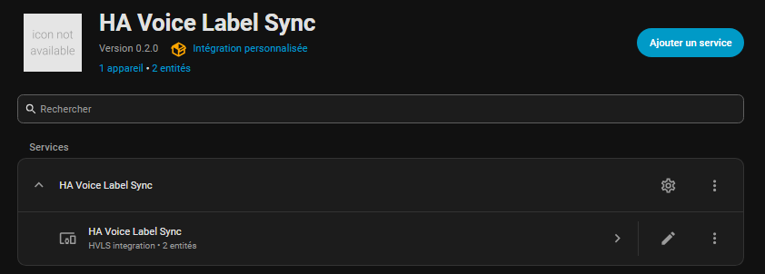
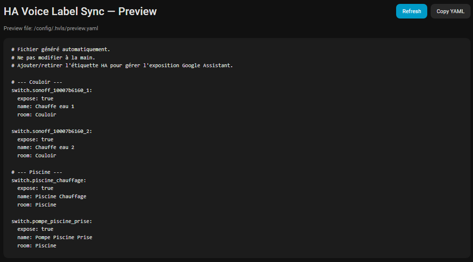
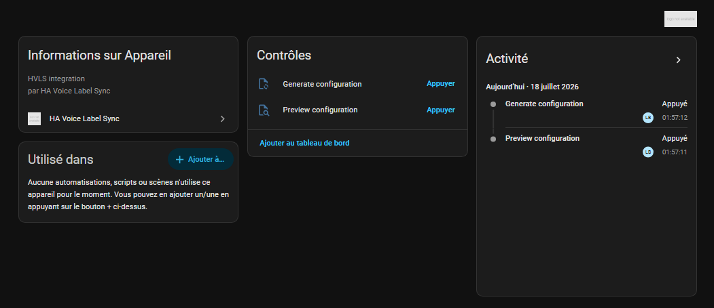

# HA Voice Label Sync

[](https://github.com/flimo44/ha-voice-label-sync/actions/workflows/python-check.yml)
[](https://github.com/flimo44/ha-voice-label-sync/releases/latest)

> **Manage once in Home Assistant. Sync everywhere.**

Generate voice assistant entity exposure configuration from **Home Assistant labels**. Choose the entities you want to expose, preview the YAML, and generate it with backup support.

> [!IMPORTANT]
> **HA Voice Label Sync (HVLS) is not a voice assistant integration.**
>
> HVLS complements an existing Home Assistant voice assistant integration. It does **not** create or configure your Google Assistant project, service account, or connection to Google Home. Set up and verify the official [Google Assistant integration](https://www.home-assistant.io/integrations/google_assistant/#manual-setup) before using HVLS.

**Current Home Assistant integration release:** **v0.3.4**  
**Python package dependency:** **v0.3.2**

> 🚧 HVLS is actively developed. Feedback, issues, and contributions are welcome.

## ✨ Why HVLS?

Maintaining large Google Assistant `entity_config` sections manually can become tedious and error-prone. HVLS lets you manage exposure through labels in Home Assistant and generate a dedicated configuration file.

- 🏷️ Select exposed entities through Home Assistant labels
- 👀 Preview the configuration before generating files
- ⚡ Generate the YAML from the Home Assistant interface
- 💾 Create automatic backups with configurable retention
- 🔍 Inspect your existing Google Assistant configuration (read-only)
- 🏠 Use a native Home Assistant integration, available through HACS
- 🔌 Extend the architecture with additional voice assistant backends in the future

## 📸 Screenshots

> Screenshots of older versions may differ slightly from the current interface.

### Home Assistant configuration



### Preview panel




### Generated YAML



### Google Assistant configuration checker (since v0.3.3)

Open **Settings → Devices & services → HA Voice Label Sync → Configure → Check Google Assistant** to inspect the configuration detected by HVLS. The checker does not modify any files.

> A screenshot of the current checker interface can be added here.

## 🚀 Installation

### Install with HACS (recommended)

**HA Voice Label Sync is listed in the official HACS catalog.** You no longer need to add this repository manually as a custom repository for a standard installation.

1. Open **HACS** in Home Assistant.
2. Search for **HA Voice Label Sync**.
3. Install the integration.
4. Restart Home Assistant.
5. Go to **Settings → Devices & services → Add integration**.
6. Search for **HA Voice Label Sync**, add it, and configure its options.

**Requirements**

- Home Assistant **2025.6.0 or later**
- For the Google Assistant backend: a working [Home Assistant Google Assistant integration](https://www.home-assistant.io/integrations/google_assistant/#manual-setup), including its Google Cloud project and service account

### Manual installation

For installations without HACS, use the repository's release source to copy `custom_components/ha_voice_label_sync` to the corresponding directory under your Home Assistant `/config/custom_components/`, then restart Home Assistant and add the integration from **Devices & services**.

[Releases](https://github.com/flimo44/ha-voice-label-sync/releases)

## ⚙️ Google Assistant configuration

HVLS generates a separate YAML file containing the entities to expose. By default, the output is:

```text
/config/google_assistant_entities.yaml
```

Reference this file from the existing `google_assistant:` configuration in your Home Assistant `configuration.yaml`:

```yaml
google_assistant:
  project_id: YOUR_PROJECT_ID
  service_account: !include google_key.json
  report_state: true
  expose_by_default: false
  entity_config: !include google_assistant_entities.yaml
```

This is an **example**: retain your existing Google Assistant project and credential configuration. HVLS only generates the entity configuration file; it does not create `google_key.json` or configure Google Cloud.

> [!NOTE]
> Restart Home Assistant after generating or modifying the included YAML so the Google Assistant integration reloads the entity configuration. Synchronizing Google Home alone does not replace this reload.

## 🔍 Check Google Assistant (v0.3.3+)

From the integration options, choose **Check Google Assistant**. This read-only diagnostic reads the relevant settings from `configuration.yaml` and displays:

- Whether a `google_assistant:` configuration was found
- The `project_id`
- Whether `report_state` and `expose_by_default` are enabled
- The `service_account` reference (such as `!include google_key.json`)
- The configured `entity_config` reference
- Whether the referenced entity configuration file exists
- Whether its path matches the output file configured in HVLS
- Warnings for detected configuration inconsistencies

The checker **does not open or read the service-account JSON file**, write to `configuration.yaml`, regenerate entity files, or change any Google Assistant setting. It provides diagnostics, not a complete validation of Google Cloud credentials or connectivity.

The integration's **HVLS settings** remain available as a separate option. Version **v0.3.4** fixes the settings form regression introduced in v0.3.3.

## 🧭 Typical workflow

```text
🏷️ Label entities in Home Assistant
                ↓
👀 Preview generated configuration
                ↓
✅ Review the YAML
                ↓
⚡ Generate the entity configuration file
                ↓
🔄 Restart Home Assistant
                ↓
🎤 Synchronize the voice assistant if needed
```

## 🏠 Home Assistant integration features

- Native configuration and options flows
- Separate **HVLS settings** and **Check Google Assistant** options
- Preview and generate actions
- Automatic backups and retention settings
- WebSocket API
- English and French translations
- Automated regression tests and GitHub Actions validation

## 🐍 Python engine and CLI

The project also provides a standalone Python package and CLI for advanced users and automation. The Python package version may differ from the Home Assistant integration version.

```bash
pip install ha-voice-label-sync
```

```bash
hvls --help

hvls \
  --storage /config/.storage \
  --output /config/google_assistant_entities.yaml \
  --label google_assistant
```

The current generation workflow uses Home Assistant `.storage` registry files. A future improvement will use Home Assistant's in-memory entity, device, area, and label registries in the native integration; **that migration is not part of v0.3.4**.

## 🎤 Supported voice assistants

| Backend | Status |
| --- | --- |
| Google Assistant | ✅ Supported |
| Amazon Alexa | 🚧 Planned |
| Apple HomeKit | 📋 Planned |

## 🏗️ Architecture

```text
 Home Assistant labels
          │
          ▼
  HA Voice Label Sync ──► Preview / review
          │
          ▼
 Generated entity_config YAML
          │
          ▼
 Official Google Assistant integration
          │
          ▼
       Google Home
```

Future backends may use the same label-driven workflow. HVLS currently supports Google Assistant for generation.

## 🧪 Tests and releases

The repository includes automated Python tests, Ruff checks, and Home Assistant/HACS validation workflows. Since **v0.3.4**, the tests also check that each options-menu destination has a corresponding handler, protecting against the regression fixed in that release.

For release notes, see [GitHub Releases](https://github.com/flimo44/ha-voice-label-sync/releases).

## 📚 Documentation and roadmap

See [ROADMAP.md](ROADMAP.md) for planned improvements. Additional documentation may be found in the [`docs/`](docs/) directory as the project evolves.

## 🤝 Contributing

Bug reports, feature requests, and pull requests are welcome. Please use [GitHub Issues](https://github.com/flimo44/ha-voice-label-sync/issues) to report problems or propose improvements.

## 📄 License

MIT
